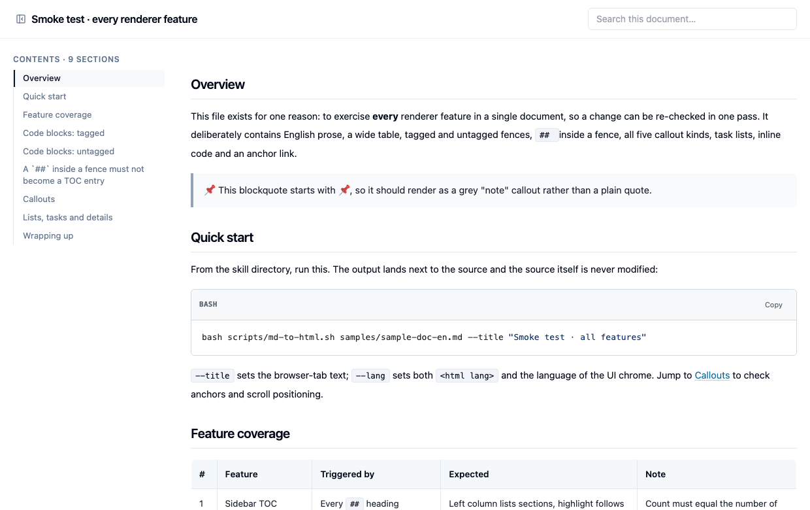

# html-artifact-builder

[](https://skills.sh/python012/html-artifact-builder)

> **English** · [简体中文](README.zh-CN.md)

An **agent skill** (per the [Agent Skills
specification](https://agentskills.io/specification)) that generates single-file,
self-contained HTML with React + shadcn/ui — lightweight, more expressive than
Markdown, no server, nothing fetched from the network, just double-click to open.

Two ways in:

| Path | Command | What you get |
|---|---|---|
| **Compose a page in React** (the main path) | `scripts/init-artifact.sh` then `scripts/bundle-artifact.sh` | One HTML file with 43 shadcn/ui components — the full expressiveness of React + Tailwind |
| **Start from an existing document** | `scripts/md-to-html.sh doc.md` | One HTML file with sidebar TOC, search, syntax-highlighted code |

> This project is a modified derivative of Anthropic's
> [`web-artifacts-builder`](https://github.com/anthropics/skills), released under
> Apache 2.0. See [NOTICE.md](NOTICE.md) for exactly what changed.

**See it first:** [open the rendered sample](https://python012.github.io/html-artifact-builder/samples/sample-doc-en.html) — the
renderer's own smoke test, already rendered to a single file.



---

## Why this exists

A single HTML file is the most direct way to hand someone something finished: no
deployment, no dead links, no "can you open this attachment". What usually stops
people is the setup — a React project, a component library, a bundler that
inlines every asset. That setup is what this skill automates: 43 shadcn/ui
components, Tailwind, and a build that emits one self-contained file.

Sometimes the content already exists as Markdown, and you would rather not design
a page by hand. `md-to-html.sh` gives that file the same treatment — still one
`.html`, but far more usable than raw Markdown:

- **Sticky sidebar TOC** with scroll-spy across every `##` section — click the
  page title to hide or show it
- **Full-text search** that jumps to the matching section, with a snippet
- **Syntax highlighting** in a light GitHub theme (highlight.js, bundled offline)
- **Copy button + language chip** on every code block
- **Callouts** derived from blockquote lead emoji: ⚠️ warning, 🔴 danger, ✅ ok, 👉 tip, 📌 note
- `## ` inside fenced code is ignored, so an embedded README template does not
  pollute the table of contents — **as long as the fences nest by length**.
  Nested fences of the same length close the outer block early (that is
  CommonMark, and GitHub agrees), so the script preflights the document first
  and warns with the exact line numbers; `--strict-fences` makes it a failure

The Markdown renderer is **verbatim**: the `.md` source is embedded as a JSON
string and parsed at runtime. The source file is never modified, and no content
is transcribed by hand (which is where silent content loss happens).

## Requirements

| Requirement | Notes |
|---|---|
| **Node.js 18+** | Checked by the init script |
| **pnpm** | Installed globally by the script if missing |
| **Network access** | Installs ~40 npm packages on first run |
| **python3** | Used to embed content and rewrite `<title>` safely |
| **Bash** | The scripts are bash. macOS / Linux / WSL natively; on Windows use **Git Bash** |

There is no zero-dependency mode. If you need one, do not use this skill — write
a static HTML file instead.

**Windows.** Run the scripts from **Git for Windows → Git Bash**, or from WSL —
not from PowerShell or `cmd`. Python is not assumed to be called `python3`: the
scripts probe `python3` → `python` → `py` and use the first one that is really
Python 3 (python.org's Windows installer ships `python.exe` and `py.exe` only,
and the Microsoft Store alias leaves a `python3.exe` stub that fails).
Line endings are pinned to LF by `.gitattributes`, so a default Windows checkout
(`core.autocrlf=true`) will not mangle the scripts.

## Install

The quickest way:

```bash
npx skills add python012/html-artifact-builder
```

That copies the skill into the project's `.agents/skills/` and links it for the
agent you pick (Claude Code, OpenCode, Codex, Cursor and ~75 more). Add `-g` for
a user-level install. Requires Node 22.20+.

Or install by hand — skills are discovered from the filesystem, so copy this
directory into one of:

| Tool | Location |
|---|---|
| **DSH** | `~/.dsh/skills/` or `~/.agents/skills/` |
| **OpenCode** | `~/.config/opencode/skills/`, `~/.claude/skills/`, or `~/.agents/skills/` |
| **Claude Code** | `~/.claude/skills/` |
| **GitHub Copilot** | `.github/skills/` inside a repository |

`~/.agents/skills/` works for DSH, OpenCode and Claude-compatible agents at
once, so it is the pragmatic choice for a shared install:

```bash
git clone https://github.com/<you>/html-artifact-builder.git \
  ~/.agents/skills/html-artifact-builder
```

Note the directory name must match the `name:` field in `SKILL.md`.

## Usage

### React → single HTML

```bash
bash scripts/init-artifact.sh my-artifact     # scaffold
cd my-artifact
# edit src/App.tsx, importing from '@/components/ui/*'
bash ../scripts/bundle-artifact.sh            # emits bundle.html
```

The bundle script runs a self-containment check and prints either:

```
✅ Self-contained: no root-relative refs, no import-maps.
```

or exits non-zero with a list of what leaked. That is a bug, not a cosmetic
warning — usually an asset was referenced by absolute path instead of inlined.

### Markdown → single HTML

```bash
bash scripts/md-to-html.sh samples/sample-doc-en.md --title "Smoke test · all features"
```

Writes `sample-doc-en.html` next to the source. The source is never modified.
The committed result is [samples/sample-doc-en.html](https://python012.github.io/html-artifact-builder/samples/sample-doc-en.html).

**Pick the title deliberately.** Markdown has no title metadata, and the `<title>`
is what shows in the browser tab. Use a short human-readable name rather than the
raw H1, which is usually too long and often carries dates and emoji:

| Avoid (raw H1) | Prefer (`--title`) |
|---|---|
| `Smoke test · every renderer feature` | `Smoke test · all features` |
| `Release notes · bundler moved from Parcel to Vite, and what broke` | `Release notes · Parcel to Vite` |

If omitted, the title falls back to the first H1, then the filename. `<html lang>`
is set explicitly, or auto-detected (`zh-CN` vs `en`) from CJK density; the same
value also switches the UI chrome (sidebar heading, search placeholder, copy
button) to that language.

## Keeping the output self-contained

The one rule that matters: **never reference a file by absolute path.**

| Do | Don't |
|---|---|
| Inline SVG, or use `lucide-react` icons | Import `.png`/`.svg` from `src/assets` |
| CSS gradients, borders, shapes | Reference `/images/foo.png` |
| System font stacks | Load Google Fonts via `<link>` |
| Inline TS data objects | `fetch()` a local JSON file |

## Design note

Avoid what reads as machine-generated: centered everything, purple gradients,
uniform rounded corners, Inter as a default. Prefer a deliberate palette and
real information density, with colour used semantically (green = pass,
amber = below target).

## License

- This project: **Apache License 2.0** — see [LICENSE.txt](LICENSE.txt)
- Upstream `anthropics/skills`: Apache License 2.0, Copyright 2026 Anthropic, PBC.
- Bundled shadcn/ui components: **MIT**, Copyright (c) 2023 shadcn — see
  [licenses/shadcn-ui-MIT.txt](licenses/shadcn-ui-MIT.txt)
- Modifications are documented in [NOTICE.md](NOTICE.md), as required by
  Apache 2.0 Section 4(b).

Per Apache 2.0 Section 6, no trademark rights are granted. This project is not
affiliated with or endorsed by Anthropic.
